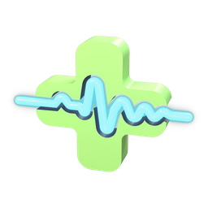
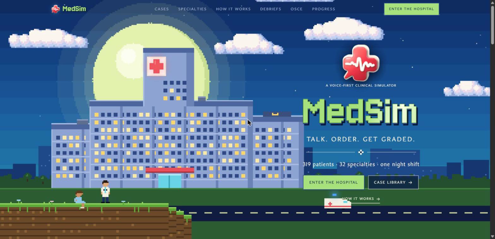
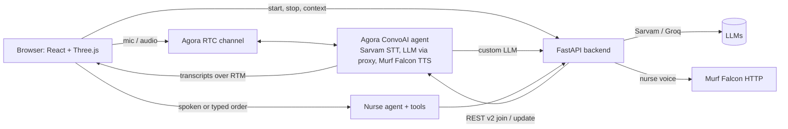

<p align="center">
  
</p>

<h1 align="center">MedSim</h1>

<p align="center"><strong>A voice-first clinical training simulator. Walk into a 3D Indian hospital, talk to an AI patient in English, Hindi or Kannada, speak your orders, and an AI charge nurse carries them out, then grades how you did.</strong></p>

<p align="center">Agora Conversational AI · Murf Falcon · Sarvam · React Three Fiber · FastAPI</p>

<p align="center"><a href="https://medsim-0cla.onrender.com">Live demo</a> · <a href="#run-it">Run it</a> · <a href="#how-agora-murf-and-sarvam-are-used">How it works</a></p>

<p align="center">
  
  
  
  
  
  
</p>

---

## The problem

- Doctors learn history taking, ordering and prescribing on real patients, with little safe practice before that.
- OSCE-style practice needs trained actors and examiners, so most students in India get a few sessions a year.
- Text quizzes don't train what matters at the bedside: listening, asking the right follow-up, and catching a dangerous order before it happens.

## The solution

MedSim gives every student an unlimited, always-available ward: patients who talk back in Indian English, and a nurse agent who executes orders, catches mistakes and explains why.
You practise the full loop by voice (interview, order, adapt, prescribe, follow up) and get graded at the end.

<p align="center"></p>

## What it does

- **3D hospital, third person.** Walk your doctor down a corridor of 36 doors. 32 clinics are open with 319 Indian patients, plus a Radiology reading room and a Teacher Portal.
- **Talk to the patient.** A real-time voice conversation through Agora. Patients answer only what you ask, hesitate, worry and ask questions back.
- **Examine by voice.** "Let me listen to your chest." Findings consistent with the case appear on the chart, with real heart and lung sounds on a stethoscope button.
- **English, Hindi or Kannada.** One toggle switches the patient, nurse, coach and teacher. Murf speaks the language and Sarvam understands whichever you use.
- **Speak orders, the nurse does them.** "Get an ECG and a troponin, start aspirin 75." Nurse Asha plans and runs tool calls (`find_in_catalog`, `order_test`, `check_allergies_and_interactions`, `prescribe`, `schedule_follow_up`), puts the results on the chart, and confirms by voice.
- **She adapts.** A penicillin allergy blocks amoxicillin: she holds it and tells you why. A stocked strength differs from your dose: she says so.
- **Mistake alerts.** Allergy conflicts, prescribing before any history, or an irrelevant or harmful test raise an alert. Press "?" and she explains the principle.
- **Radiology reading room.** 18 real X-rays, ECGs, CT heads and ultrasounds (credited Wikimedia images). Describe the film aloud, Dr. Vikram Rao asks one probing question, and you're graded on the findings you caught and missed.
- **OSCE exam mode.** A timed 8-minute station with no hints, marked like a real examiner: a checklist with evidence quotes, critical errors and a pass/fail global rating. Save it as a PDF.
- **Triage drill.** Five ED arrivals in three minutes whose vitals worsen if you leave them untriaged. Assign the colour and the first action by click or by voice.
- **My progress.** Score trend, weakest domains, recurring mistakes, a streak, and what to practise next.
- **Teacher Portal.** A 3D lecture hall where Dr. Meera Iyer teaches any topic by voice, drawing it step by step on a whiteboard (ECG, Wiggers and other physiology curves are drawn from accurate code presets), then quizzes you.
- **Clinically audited cases.** Every case passes an automated consistency check (diagnosis supported, abnormal flags match reference ranges, age-appropriate doses), and a review fixed about 160 errors ([CLINICAL_AUDIT.md](src/data/CLINICAL_AUDIT.md)). 15 cases are adapted from open-access (CC BY) case reports with citations.
- **Debrief.** An overall score plus scores for history taking, diagnostic reasoning, test selection, treatment and safety, communication and disposition, with what went well and what to work on.

## How Agora, Murf and Sarvam are used

- **Agora Conversational AI** runs every voice: the patient, the teacher and the radiologist. The backend mints RTC + RTM tokens and starts an agent with REST v2 `/join`. The browser joins with `agora-rtc-sdk-ng`. Transcripts arrive over Agora RTM and drive the subtitles and the nurse.
- **Sarvam** is the speech recognition inside Agora (language auto-detect) and the LLM for the patient, nurse, coach, exam findings, radiology grading, OSCE marking, teacher and debrief, with Groq as the fallback.
- **Murf Falcon** is the TTS inside Agora (Indian English voices, a stable voice per patient), and the nurse's own voice through the Murf HTTP API.
- **Custom LLM route.** Agora calls `/llm/patient/chat/completions` on our backend. It turns noise-only turns into "(inaudible)" before Sarvam sees them, so the patient never breaks. A per-agent token guards it, and the Sarvam key never leaves the server.
- **Live context.** `/voice/context` updates the running agent's prompt, so the patient knows which tests and drugs were ordered. Filler words and tuned turn detection keep it sounding human.

## Architecture



One FastAPI process serves the API and the built frontend. State lives in a single `Store` class in the browser.

## Run it

Requires Node 22+, Python 3.12, and keys for Agora (App ID, certificate, Conversational AI customer ID and secret), Murf, Sarvam and Groq. Names are in `backend/.env.example`.

```bash
npm ci
python -m venv backend/.venv
backend/.venv/Scripts/python.exe -m pip install -r backend/requirements.txt
cp backend/.env.example backend/.env.local      # fill in the keys

backend/.venv/Scripts/python.exe backend/server.py   # API on 127.0.0.1:8787
npm run dev                                          # app on http://localhost:5173
```

Locally, set `PATIENT_LLM_TUNNEL=cloudflared` to use the noise-safe LLM route through a Cloudflare quick tunnel. On a server, set `PUBLIC_URL` instead. Deployment is one Render web service; see [DEPLOY.md](DEPLOY.md).

**Controls:** WASD walk, Shift run, mouse to look, E use a door, T talk, N next patient, Esc menu.

**Tests:** `npm run verify`, `npm test`, and `backend/.venv/Scripts/python.exe -m unittest discover backend/tests`.

## Disclaimer

A training tool, not medical advice. Synthetic cases are plausible but not clinically validated. Real-case adaptations cite their sources in [src/data/REAL_CASES.md](src/data/REAL_CASES.md).

## License

Code is [MIT](LICENSE). Third-party 3D assets, fonts and case reports keep their own licences, listed in [public/assets/CREDITS.md](public/assets/CREDITS.md) and [src/data/REAL_CASES.md](src/data/REAL_CASES.md). One character model is CC BY-NC 4.0, so replace it before any commercial use.
