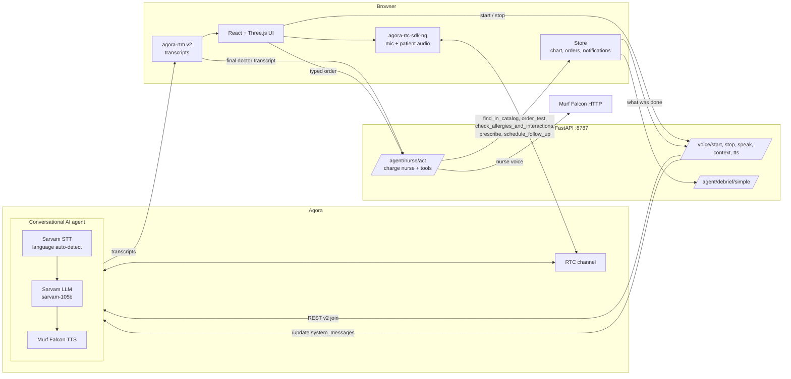

# MedSim

Talk to a synthetic patient, speak your orders, and watch an AI charge nurse carry them out. A browser-based clinical training simulator built on Agora Conversational AI and Murf Falcon.

**Hackathon:** Build with Agora - Bengaluru 2026 (solo)
**Track:** 3, "AI Agents That Get Things Done"
**Required pieces:** Agora Conversational AI, Murf AI Falcon TTS, agentic tool calls, working demo.

## Demo flow

One polyclinic encounter, mapped to the track's agent loop:

| Stage | What happens in the encounter |
|---|---|
| **Initiate** | You walk your doctor avatar down the hospital corridor, pick a specialty door (24 of them), and sit down with a patient. `POST /voice/start` joins you to an Agora channel with a live patient agent. You interview the patient by voice. |
| **Plan** | You say: "Get a CBC and a chest X-ray, and start amoxicillin." The spoken order (final transcript) triggers `POST /agent/nurse/act`. The charge nurse agent plans the tool calls it needs. |
| **Execute** | The nurse runs at least two coordinated tool calls: `find_in_catalog`, `order_test`, `check_allergies_and_interactions`, `prescribe`. Results land in the chart. |
| **Adapt** | The allergy check finds a penicillin allergy. The nurse holds amoxicillin, tells you why, and proposes an alternative instead of blindly executing. |
| **Confirm & Follow-up** | The nurse speaks the summary in her own Murf Falcon voice, calls `schedule_follow_up`, and `/voice/context` updates the patient agent so the patient knows what was done. A debrief grades your work. |

## Architecture



## Tech stack

| Layer | Technology |
|---|---|
| Frontend | React 18, TypeScript, Vite |
| 3D | Three.js via `@react-three/fiber` and `@react-three/drei` |
| 2D UI | Pixel-art night/paper design system (Jersey 10 + Amarna fonts) |
| State | Single `Store` class + `useSyncExternalStore` |
| Realtime voice | Agora RTC (`agora-rtc-sdk-ng`), Agora RTM v2 (`agora-rtm`) for transcripts |
| Voice agent | Agora Conversational AI Engine (REST v2) |
| STT | Sarvam, run inside Agora, language auto-detect |
| LLM (patient) | Sarvam `sarvam-105b` (OpenAI-compatible); Groq or Agora-managed OpenAI as fallbacks |
| TTS | Murf AI Falcon (Agora vendor `murf`) |
| Backend | FastAPI, single process, `127.0.0.1:8787` |
| Nurse and debrief LLM | Sarvam, falling back to Groq |
| Optional | Anthropic Managed Agent "attending" (Opus), only if `ANTHROPIC_API_KEY` is set |

## How Agora and Murf are used

**Agora**
- `POST /voice/start` mints an RTC token and an RTM token (vendored AgoraIO token builder in `backend/agora_token/`), then calls the Conversational AI REST v2 `/join` to start an agent in the channel. Body: `{caseId, systemPrompt, initialLine, gender, locale?}`. Response: `{appId, channel, uid, token, agentUid, agentId}`.
- The browser joins the channel with `agora-rtc-sdk-ng`, publishes the mic, and plays the agent's audio. Transcripts arrive over Agora RTM and drive the on-screen conversation and the order detection.
- ASR is Sarvam STT configured inside the Agora agent (`VOICE_ASR=sarvam`, language auto-detect). LLM is Sarvam via its OpenAI-compatible API (`PATIENT_LLM_PROVIDER` = `sarvam` | `groq` | `managed`).
- Custom LLM route: with `PATIENT_LLM_TUNNEL=cloudflared` the backend opens a Cloudflare quick tunnel and registers `POST /llm/patient/chat/completions` as the agent's LLM (`vendor: "custom"`). This proxy turns empty, noise-only user turns into "(inaudible)" before calling Sarvam, which otherwise rejects them with HTTP 400 and makes the patient say the failure line. Each agent gets its own short-lived bearer token; the Sarvam key never leaves the backend. Without a verified tunnel the backend calls Sarvam directly.
- Turn detection is tuned for noisy rooms: `speech_threshold` 0.6, `interrupt_duration_ms` 240, `silence_duration_ms` 640.
- `POST /voice/context` calls Agora `/update` with new `llm.system_messages`, the only updatable field, so the patient knows which tests and drugs were ordered.
- `POST /voice/speak` makes the agent say a line (patient farewell). `POST /voice/stop` is idempotent.
- The project `.mcp.json` registers the `agora-docs` MCP server (`https://mcp.agora.io`).

**Murf Falcon**
- Patient voice: Murf is the TTS vendor (`murf`) inside the Agora agent config. Voice IDs come from `MURF_VOICE_MALE` and `MURF_VOICE_FEMALE` by patient gender; region from `MURF_REGION`.
- Nurse voice: `POST /voice/tts` `{text, voice?: 'nurse'|'M'|'F'}` calls the Murf Falcon HTTP API and returns `audio/mpeg`. The voice defaults to `MURF_NURSE_VOICE`.

**Agentic nurse** (`POST /agent/nurse/act`, `backend/nurse.py`): a function-calling loop with server-side tools `find_in_catalog`, `order_test`, `check_allergies_and_interactions`, `prescribe`, `schedule_follow_up`. It plans, executes at least two coordinated calls, adapts to what the tools return, and confirms by voice. It fires automatically on the doctor's final transcripts or on typed orders.

## Setup

**Prerequisites:** Node 22+, Python 3.12.

**Keys** (all server-side, in `backend/.env.local`; the browser never sees them):

| Variable | Where to get it |
|---|---|
| `AGORA_APP_ID`, `AGORA_APP_CERTIFICATE` | [console.agora.io](https://console.agora.io): create a project with the App Certificate enabled |
| `AGORA_CUSTOMER_ID`, `AGORA_CUSTOMER_SECRET` | Same console, RESTful API credentials; enable Conversational AI on the project |
| `MURF_API_KEY`, `MURF_REGION` | [murf.ai/api](https://murf.ai/api) dashboard |
| `SARVAM_API_KEY` | [dashboard.sarvam.ai](https://dashboard.sarvam.ai) |
| `GROQ_API_KEY` | [console.groq.com](https://console.groq.com) (fallback LLM) |
| `PATIENT_LLM_PROVIDER` | `sarvam` (default), `groq`, or `managed` |
| `PATIENT_LLM_TUNNEL` | `cloudflared` to route the patient LLM through the noise-safe proxy (needs `cloudflared` installed), or set `PUBLIC_URL` to your own HTTPS URL |
| `ANTHROPIC_API_KEY` | Optional, only for the Opus attending |

`backend/.env.example` has the full list.

```bash
# install
npm install
cd backend
python -m venv .venv
.venv/Scripts/python.exe -m pip install -r requirements.txt
cp .env.example .env.local     # then fill in keys
cd ..
```

## Run

Two terminals, no separate voice worker:

```bash
# 1. backend (127.0.0.1:8787)
backend/.venv/Scripts/python.exe backend/server.py

# 2. frontend (Vite proxies /agent/* and /voice/* to the backend)
npm run dev
```

Allow microphone access when the browser asks. Check `GET http://127.0.0.1:8787/health` to see which providers are configured; `llm.patient_route` shows `proxy via <host>` once the tunnel is verified (usually 15 to 90 s after start).

**Before a live demo:** start the backend a few minutes early and run one short warm-up conversation. The very first request through a brand-new tunnel can take up to ~25 s while Agora's cloud resolves the new hostname; later turns answer in about 1 to 2 s.

## Controls

Third-person camera: you always see your doctor avatar.

- `W` `A` `S` `D`: walk; `Shift`: run
- Drag: look around; mouse wheel: zoom
- `E`: open the door you are facing (built clinics open, the rest show "Coming soon"); in a clinic, `E` at the exit door returns to the corridor
- `T` (in a clinic): connect or hang up the voice conversation with the patient
- `N` (in a clinic): done with this patient, call the next one
- `Esc`: menu (leave room, case library, leave the hospital)

The in-game hints always show the current bindings.

## Commands

| Command | What it does |
|---|---|
| `npm run dev` | Vite dev server |
| `npm run build` | `tsc -b` + Vite build |
| `npm run preview` | Preview the production build |
| `npm run verify` | Deterministic invariant checks on `src/data/*` and the 3D scene |
| `npm test` | Node test runner, `scripts/test/` |

On machines where group policy blocks `.exe` shims in `node_modules/.bin/`, the npm scripts already call `node node_modules/<pkg>/bin/<entry>.js` directly.

## Project structure

```
src/
  game/         store.ts (single state source), types.ts, clinic.ts (24 specialties)
  data/         pure data: 240 polyclinic cases, tests, treatments, medications
  voice/        Agora RTC/RTM session, persona prompt builder
  agents/       nurse agent client, simple debrief, optional managed attending
  components/   screens, encounter HUD, three/ (corridor, clinic room, avatar)
  styles/       design tokens
backend/
  server.py     FastAPI app: /voice/*, /agent/*, /health
  voice.py      Agora Conversational AI + Murf wiring
  nurse.py      charge nurse agent and tools
  debrief.py    JSON debrief grading
  llm_provider.py  Sarvam / Groq / managed selection
  agora_token/  vendored AgoraIO token builder
  tests/        unittest suite
scripts/        verify/ and test/ runners
agent/skills/   skill prompts for case generation, roleplay, simulation tick
docs/           design system capture, evolution log
spec.md         hackathon submission plan
```

## Testing

```bash
npm run verify
npm test
backend/.venv/Scripts/python.exe -m unittest discover backend/tests
```

Two tests in `npm test` currently fail because `.claude/commands/medsim-verify-simulation.md` and `medsim-idea-evolve.md` do not exist in the repo. They are unrelated to the voice or nurse features.

## Limitations and disclaimer

- Cases are synthetic and plausible, not clinically validated. **This is a training toy, not medical advice**, and makes no claim of clinical accuracy.
- Single-player, single-shift, no accounts, no persistence beyond the browser session.
- Desktop browsers only. Unbuilt specialty domains show "Coming soon".
- Pharmacology covers only the curated `src/data/medications.ts` table.
- Patient and nurse quality depend on the Sarvam/Groq models and on the network.

## Credits

- Agora Conversational AI, Murf AI Falcon, Sarvam AI, Groq.
- 3D assets: no `public/assets/CREDITS.md` is present yet. TODO: add attributions for any third-party models once they land.
- Fonts: Jersey 10, Amarna.

## License

TODO: license not decided.
