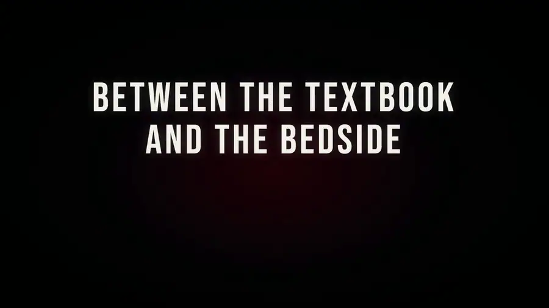
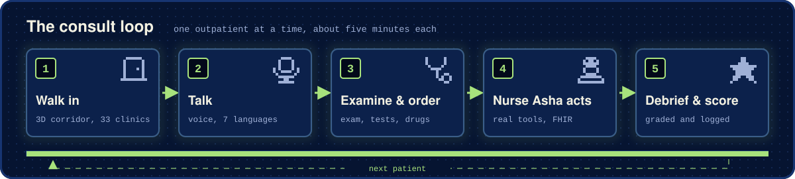
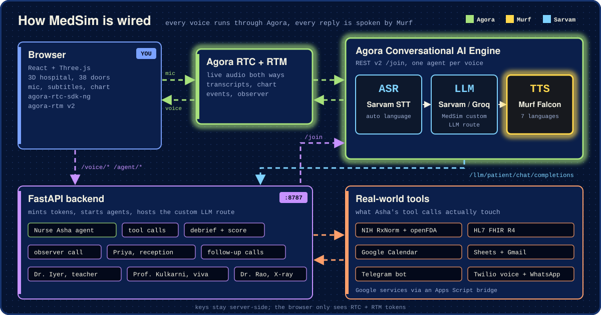
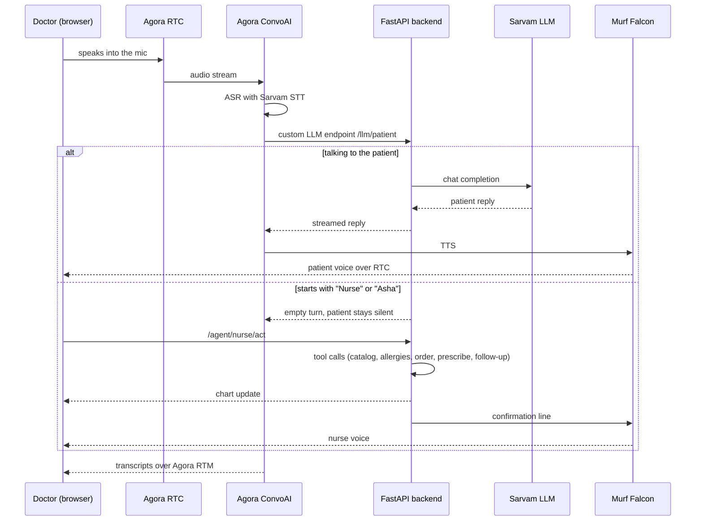

<p align="center"></p>

<p align="center">
  <a href="https://medsim-0cla.onrender.com"></a>
  
  
  
  
  
  <a href="LICENSE"></a>
</p>

<p align="center">
  <a href="https://medsim-0cla.onrender.com"><b>Live demo</b></a> &nbsp;·&nbsp;
  <a href="media/trailer.mp4"><b>Watch trailer</b></a> &nbsp;·&nbsp;
  <a href="#run-it"><b>Run it</b></a> &nbsp;·&nbsp;
  <a href="#how-it-works"><b>How it works</b></a>
</p>

<p align="center"><a href="media/trailer.mp4"></a></p>
<p align="center"><a href="media/trailer.mp4">Watch the trailer with sound (MP4)</a></p>


## 🩺 What is MedSim

- **A 3D Indian hospital you walk through.** 38 doors: 33 clinics, an Operation Theatre, a Radiology reading room and a Teacher Portal.
- **Patients you talk to by voice.** They answer only what you ask, hesitate, worry and ask questions back.
- **A nurse who does what you say.** Speak an order and Nurse Asha runs it with real tool calls, catches unsafe ones and confirms by voice.
- **A grade at the end.** Every consult ends in a scored debrief, so students get safe, unlimited practice before real patients.




## ✨ Features

<table>
  <tr>
    <td width="33%" valign="top">🗣️ <b>AI patients by voice</b><br>327 cases in 33 clinics, 7 Indian languages, and mixed-language speech like Hinglish.</td>
    <td width="33%" valign="top">💉 <b>Nurse Asha, real tools</b><br>NIH RxNorm and openFDA checks, HL7 FHIR R4 records, Google Calendar invites.</td>
    <td width="33%" valign="top">📲 <b>Voice prescription</b><br>Sent by Telegram or WhatsApp with a Murf voice note in the patient's language.</td>
  </tr>
  <tr>
    <td valign="top">📞 <b>Follow-up calls</b><br>The patient talks to Asha live from their phone; red flags alert the doctor mid-call.</td>
    <td valign="top">👀 <b>Observers by phone</b><br>"Asha, invite my senior to observe" sends the Agora link and phones them.</td>
    <td valign="top">🤖 <b>Autonomous agents</b><br>Priya at reception, Dr. Iyer teaching (optional Anam avatar), Prof. Kulkarni's viva, Dr. Rao in radiology.</td>
  </tr>
  <tr>
    <td valign="top">🎓 <b>Exam modes</b><br>Timed OSCE, viva voce, 18 real radiology images and an Operation Theatre drill.</td>
    <td valign="top">🏫 <b>Assignments for institutes</b><br>Teachers set work with a code; scores record themselves and reports arrive by email.</td>
    <td valign="top">✍️ <b>Custom patients from Telegram</b><br><code>/newpatient</code>, answer 12 questions, and the patient appears in the clinic.</td>
  </tr>
  <tr>
    <td valign="top">📒 <b>Logbook and referrals</b><br>CBME logbook in Google Sheets; SBAR referrals as a Google Doc, PDF and FHIR record.</td>
    <td valign="top">📊 <b>Debrief and report cards</b><br>Scores across six clinical domains, OSCE sheets and PDF report cards.</td>
    <td valign="top">🛟 <b>Coaching and drills</b><br>Mistake alerts, "How am I doing, Asha?", 8 communication stations, triage drill.</td>
  </tr>
</table>

<details>
<summary><b>More detail</b></summary>

- **Languages:** English, Hindi, Kannada, Tamil, Telugu, Marathi, Bengali. One toggle switches every voice.
- **Asha's tools:** `find_in_catalog`, `order_test`, `check_allergies_and_interactions`, `prescribe`, `schedule_follow_up`, `send_to_patient`. A penicillin allergy blocks amoxicillin, and she says why.
- **Case quality:** automated consistency checks ([CLINICAL_AUDIT.md](src/data/CLINICAL_AUDIT.md)); 15 cases adapted from open-access reports ([REAL_CASES.md](src/data/REAL_CASES.md)).

</details>


## 🎭 The cast



| Agent | Tools it calls on its own |
|---|---|
| Priya, reception | `get_assignment_status`, `list_assignments`, `email_report_to_teacher`, `book_study_session`, `send_to_my_phone` |
| Dr. Meera Iyer, Teacher Portal | `draw_on_board`, `start_quiz`, `assign_practice`, `schedule_revision` |
| Prof. Kulkarni, viva | `record_answer_grade`, `next_question`, `end_viva` |
| Nurse Asha, follow-up call | `escalate_red_flag`, `reschedule_call`, `log_symptom` |


## ⚙️ How it works



**One spoken turn:**



**How Agora, Murf and Sarvam are used**

| Product | What for | Where |
|---|---|---|
| Agora Conversational AI | Every live voice agent: ASR, LLM and TTS in one REST v2 `/join` | `backend/voice.py` |
| Agora RTC | Mic, agent audio, listen-only observer, avatar video | `src/voice/`, `backend/observer.py` |
| Agora RTM | Transcripts, live chart events, observer whispers and marks | `src/voice/` |
| Agora metrics | Per-turn latency panel (press M), average response time in the debrief | `enable_metrics` |
| Custom LLM route | Noise-safe patient turns and in-call agent tools | `backend/agent_runtime.py` |
| Sarvam STT | Speech recognition inside Agora, language auto-detect | `backend/voice.py` |
| Sarvam LLM | Patient, nurse, coach, grading, teacher, debrief (Groq fallback) | `backend/llm_provider.py` |
| Murf Falcon | Agent voices in 7 languages, nurse, theatre team, voice prescriptions | `backend/voice.py`, `/voice/tts` |


## 🚀 Run it

1. **Prerequisites:** Node 22+, Python 3.12, and keys for Agora, Murf, Sarvam and Groq.
2. **Clone:**
   ```bash
   git clone https://github.com/DarshanKrishna-DK/MedSim.git
   cd MedSim
   ```
3. **Add your keys:**
   ```bash
   cp backend/.env.example backend/.env.local   # then fill in the keys
   ```
4. **Start the backend** (API on `127.0.0.1:8787`):
   ```bash
   python -m venv backend/.venv
   backend/.venv/Scripts/python.exe -m pip install -r backend/requirements.txt
   backend/.venv/Scripts/python.exe backend/server.py
   ```
5. **Start the app** (on `http://localhost:5173`):
   ```bash
   npm install
   npm run dev
   ```

> **Windows, one click:** after step 3, double-click `start-medsim.bat`. It installs what's missing, starts both servers and opens the browser.

**Controls:** WASD walk, Shift run, mouse look, E use a door, T talk, N next patient, Esc menu.

<details>
<summary><b>Environment variables</b> (names only, see <code>backend/.env.example</code>)</summary>

| Group | Variables |
|---|---|
| Agora (required) | `AGORA_APP_ID`, `AGORA_APP_CERTIFICATE`, `AGORA_CUSTOMER_ID`, `AGORA_CUSTOMER_SECRET` |
| Murf (required) | `MURF_API_KEY`, `MURF_REGION`, optional `MURF_VOICE_MALE`, `MURF_VOICE_FEMALE`, `MURF_NURSE_VOICE` |
| LLMs (required) | `SARVAM_API_KEY`, `SARVAM_MODEL`, `GROQ_API_KEY`, `GROQ_MODEL`, `PATIENT_LLM_PROVIDER` |
| Public URL | `PUBLIC_URL` or `PATIENT_LLM_TUNNEL=cloudflared`, `BACKEND_PORT`, `VOICE_ASR` |
| Messaging (optional) | `TELEGRAM_BOT_TOKEN`, `TWILIO_ACCOUNT_SID`, `TWILIO_AUTH_TOKEN`, `TWILIO_WHATSAPP_FROM`, `TWILIO_SMS_FROM`, `TWILIO_VOICE_FROM`, `SMTP_HOST`, `SMTP_PORT`, `SMTP_USER`, `SMTP_PASSWORD`, `SMTP_FROM`, `DOCTOR_ALERT_DEST` |
| Avatar (optional) | `AVATAR_VENDOR`, `AVATAR_API_KEY`, `AVATAR_ID`, `AVATAR_QUALITY` |
| Attending (optional) | `ANTHROPIC_API_KEY`, `MEDSIM_AGENT_ID`, `MEDSIM_ENV_ID` |

Agent tools and the noise-safe patient route need a public HTTPS URL. Locally, set `PATIENT_LLM_TUNNEL=cloudflared`; on a server, set `PUBLIC_URL`.

</details>

<details>
<summary><b>Troubleshooting</b></summary>

| Problem | Fix |
|---|---|
| Mic silent | Check the mic permission, reload, press **Connect voice** again, or type |
| Echo, or the AI interrupts itself | Use headphones |
| Voice agent will not start | Check `/health` and the backend logs (Agora minutes or keys) |
| Patient silent after noise | Speak a full sentence; noise-only turns become "(inaudible)" |
| Language toggle does nothing mid-call | End and restart the consultation |
| Tunnel route not ready | It turns on 15 to 90 s after start; see `llm.patient_route` in `/health` |

Everything also works by typing if voice fails.

</details>


## ☁️ Deploy

- **One Render web service** (`render.yaml`, Python 3.12, Singapore) serves the FastAPI API and the built app from `dist/`, same origin, no CORS.
- **Build:** `pip install -r backend/requirements.txt && npm ci && npm run build`
- **Start:** `cd backend && uvicorn server:app --host 0.0.0.0 --port $PORT`; health check at `/health`, autodeploy from `main`.
- **Env vars** go in the Render dashboard, never in git: the Agora, Murf, Sarvam and Groq keys plus `PATIENT_LLM_PROVIDER=sarvam`.
- **Set `PUBLIC_URL` and `FRONTEND_ORIGINS`** to `https://<service>.onrender.com` so Agora reaches the LLM route with no tunnel (leave `PATIENT_LLM_TUNNEL` unset).
- **Free plan** sleeps after 15 minutes idle; the first request takes about 50 s.


## 🧪 Tests

```bash
npm run verify                                                # data and scene invariants
npm test                                                      # frontend tests
backend/.venv/Scripts/python.exe -m unittest discover backend/tests   # backend tests
```


## 🌱 Vision

- **Institutes assign practice:** faculty set cases, OSCEs and vivas for a whole class and get reports back.
- **The library grows with its users:** faculty and students contribute their own agent patients, starting from Telegram today.
- **Every student, every language:** unlimited bedside practice in the language they think in.

> **Not medical advice.** MedSim is a training simulator. Cases are synthetic and plausible but not clinically validated; real-case adaptations cite their sources in [REAL_CASES.md](src/data/REAL_CASES.md).

---

<p align="center">
  <b>MedSim</b>, The Voice-First Clinical Simulator<br>
  Code under the <a href="LICENSE">MIT license</a>. Third-party assets keep their own licences: <a href="public/assets/CREDITS.md">CREDITS.md</a>. One character model is CC BY-NC 4.0, so replace it before commercial use.
</p>
